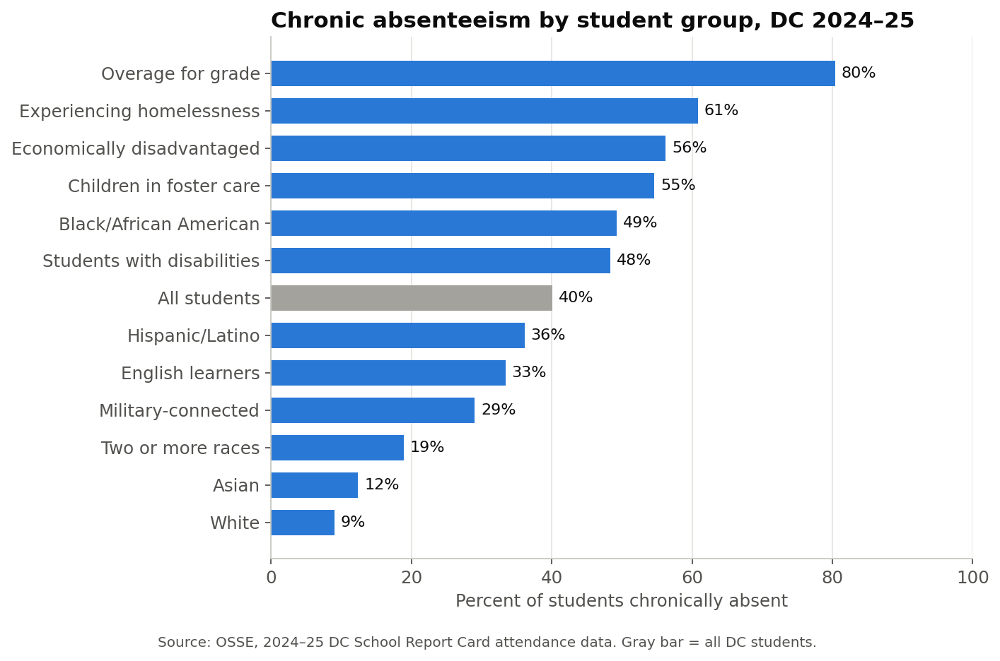
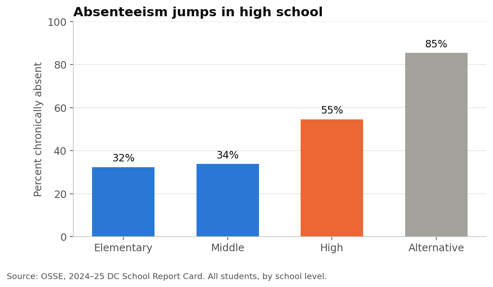
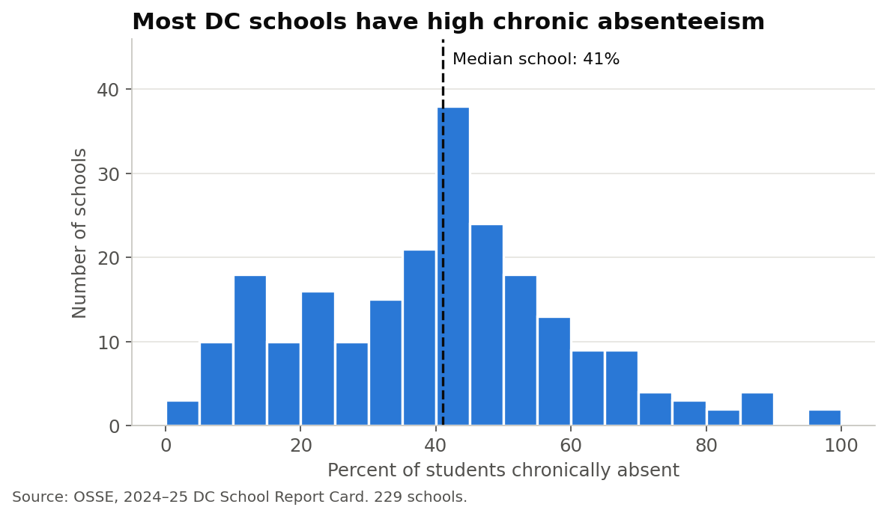
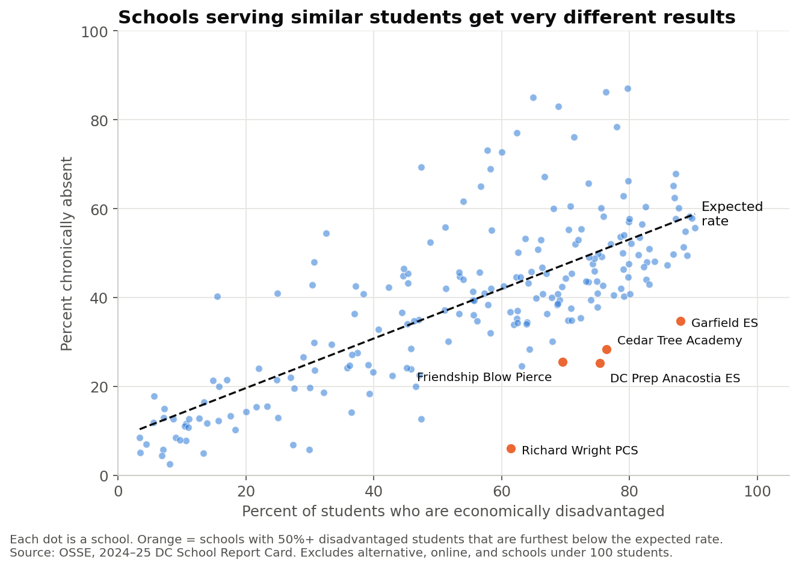
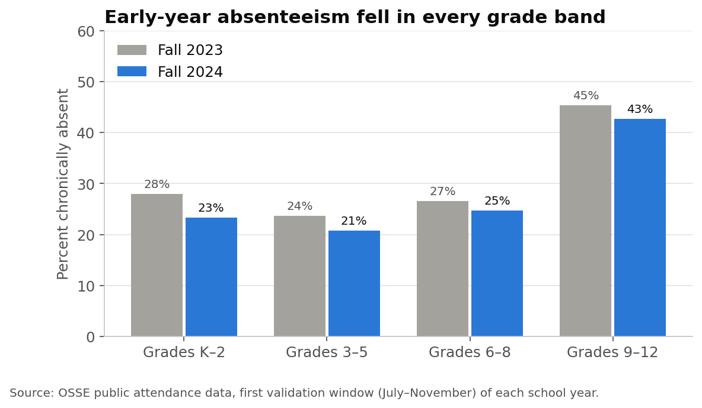

# Chronic Absenteeism in DC Public Schools (2024–25)

**4 in 10 DC students were chronically absent in 2024–25.** This project uses public data from DC's Office of the State Superintendent of Education (OSSE) to show which students and schools are most affected, where attendance breaks down, and which schools do far better than expected for the students they serve.

[](https://colab.research.google.com/github/idaminimishra/dc-chronic-absenteeism/blob/main/dc_chronic_absenteeism.ipynb)

**Tools:** Python (pandas, NumPy, Matplotlib), Google Colab
**Author:** Damini Mishra · [Portfolio](https://idaminimishra.github.io) · [LinkedIn](https://www.linkedin.com/in/idaminimishra)

---

## Key findings

1. **40% of DC students were chronically absent**, meaning they missed at least 10% of school days.
2. **Absenteeism tracks economic hardship.** 56% of economically disadvantaged students and 61% of students experiencing homelessness were chronically absent, compared with 9% of White students.
3. **High school is the breaking point.** Rates are similar in elementary (32%) and middle school (34%), then jump to 55% in high school.
4. **Schools serving similar students get very different results.** Five schools where most students are economically disadvantaged have rates 22 to 37 points below what we'd expect.
5. **Attendance is improving.** Early-year absenteeism fell in every grade band from fall 2023 to fall 2024, and 70% of schools improved.

## Recommendations

1. **Focus on the move into high school.** Use 8th-grade attendance to identify students at risk before they start 9th grade, and give each one an adult mentor who checks in during the first weeks of high school.
2. **Remove practical barriers for students facing hardship.** For students who are economically disadvantaged or experiencing homelessness, the barriers are often transportation, health, and housing. Pair attendance data with family outreach to find out which barriers matter most at each school.
3. **Learn from schools that beat the odds.** Visit the schools that do much better than expected, document what they do, and share those practices with similar schools.

---

## The analysis

### Which students are most affected?



### Absenteeism jumps in high school



Even in the first months of the year, about **15% of high school students had already missed 30% or more of school days**, roughly one day in three.

### Most DC schools have high chronic absenteeism



At the typical school, 41% of students were chronically absent. At 64 schools (28%), at least half of all students were.

### Which schools beat the odds?

Ranking schools by raw absenteeism mostly ranks them by how many students facing hardship they serve. Instead, I compared each school with the rate expected for its share of economically disadvantaged students, using a simple trend line. The share of disadvantaged students is strongly linked to absenteeism (correlation 0.75), yet some schools are far below the line.



| School | % economically disadvantaged | Actual rate | Expected rate | Difference |
|---|---|---|---|---|
| Richard Wright PCS for Journalism and Media Arts | 61% | 6% | 43% | −37 points |
| DC Prep PCS – Anacostia Elementary | 75% | 25% | 50% | −25 points |
| Garfield Elementary School | 88% | 35% | 58% | −23 points |
| Cedar Tree Academy PCS | 76% | 28% | 51% | −23 points |
| Friendship PCS – Blow Pierce Middle | 70% | 26% | 47% | −22 points |

These results are a starting point for questions, not a final verdict. A large gap can reflect strong practices, but it can also reflect changes in how attendance is recorded or who enrolls. The next step would be to talk with these schools.

### Is attendance getting better?



---

## Method

1. **Cleaned suppressed values.** OSSE hides results for small groups to protect student privacy (for example `n<10` or `<5%`). I treated these as missing rather than guessing them.
2. **Calculated each school's share of economically disadvantaged students** by dividing the number of students in that group by the school's total.
3. **Fit a linear trend line** of absenteeism against that share, and measured each school's difference from its expected rate.
4. **Left out** alternative schools, one online school, and schools with fewer than 100 students from the comparison, because they aren't comparable with regular schools.

## Limitations

- This is school-level public data. It shows patterns across schools, not why individual students miss school.
- Correlation is not causation. The link with economic disadvantage shows where to look, not what causes absences.
- The expected rate uses one factor. A fuller model would also account for school level and other student needs.
- OSSE counts students once per school they attend, so citywide figures are close estimates.
- The fall comparison covers only July–November of each year, so its rates are lower than full-year rates.

## Data

| File | Source | Coverage |
|---|---|---|
| `data/chronic_absenteeism_2024-25.xlsx` | OSSE, 2024–25 Chronic Absenteeism Metric Scores (DC School Report Card) | Full 2024–25 school year, by school, school level, and student group |
| `data/attendance_fall_2024.xlsx` | OSSE, Attendance Data Public Reporting (March 2025 release) | July–November 2024, compared with the same period in 2023 |

Both files are public and available from [OSSE's 2024–25 attendance reporting page](https://osse.dc.gov/page/2024-25-school-year-attendance-reporting). No student-level data is used.

## How to run

Click **Open in Colab** at the top of this page, then choose **Runtime → Run all**. The notebook downloads the data automatically. To run it on your own computer, install `pandas`, `numpy`, `matplotlib`, and `openpyxl`, then open `dc_chronic_absenteeism.ipynb` in Jupyter.

## Repository structure

```
dc-chronic-absenteeism/
├── dc_chronic_absenteeism.ipynb   # full analysis with explanations
├── data/                          # OSSE source files
├── images/                        # charts used in this README
└── README.md
```
